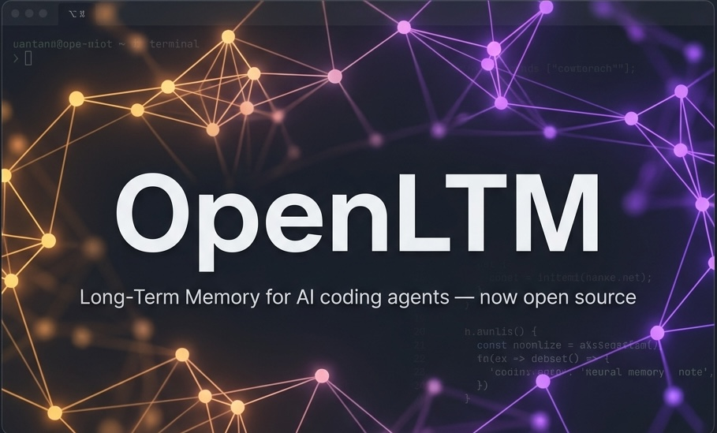

<div align="center">



# OpenLTM: long-term memory for AI coding agents

**Persistent, local-first memory for Claude Code, OpenCode, Pi, OpenClaw and Hermes.**
Your agent remembers decisions, conventions and gotchas across sessions, in one SQLite file on your disk.

[](CHANGELOG.md)
[](LICENSE)
[](https://www.npmjs.com/package/@rohirik/openltm-core)
[](https://modelcontextprotocol.io)
[](https://sqlite.org)
[](https://bun.sh)

[Quick start](#quick-start) · [Features](#features) · [Supported agents](#supported-agents) · [Docs](docs/README.md) · [Changelog](CHANGELOG.md)

</div>

---

## Why OpenLTM

You explained your auth layer once. Why does your agent ask again tomorrow?

AI coding agents forget everything when a session ends or the context window compacts. OpenLTM gives them a **long-term memory**: hooks capture what was learned, and the next session starts with the relevant memories already in context. No cloud account, no telemetry, no Docker stack.

- **Automatic.** Session hooks save and inject memories; you don't have to remember to remember.
- **Search by meaning.** Hybrid recall: SQLite FTS5 full-text search plus vector embeddings, fused with Reciprocal Rank Fusion.
- **Local and private.** One SQLite database you own. Embeddings run on a local [llama.cpp](https://github.com/ggerganov/llama.cpp) server by default.
- **One memory, every agent.** Claude Code, OpenCode, Pi, OpenClaw and Hermes share the same database, so a gotcha learned in one is there in the others.
- **Memories age.** Decay, supersede and a janitor keep the store small and current instead of hoarding transcripts.

## Quick start

**Claude Code** (2.1.275 or later):

```bash
claude plugin install openltm --marketplace RohiRIK/OpenLtm
```

Restart Claude Code. The hooks wire themselves and the database is created on first run. Then, in a session:

```
/openltm:memory recall auth       what do we know about auth here?
/openltm:memory learn <insight>   save something worth keeping
/openltm:health                   memory health and decay summary
```

**Turn on search by meaning** (optional; without it recall uses full-text search only):

```bash
llama-server -m bge-m3.gguf --embeddings --pooling mean --port 8080
```

Run `/openltm:doctor` to confirm semantic recall is on. Five-minute guide: [Local embeddings](docs/15-local-embeddings.md).

Other agents, `bunx` and git-clone installs: [Installation](docs/01-installation.md).

## Supported agents

| Agent | Install |
|---|---|
| Claude Code | `claude plugin install openltm --marketplace RohiRIK/OpenLtm` |
| OpenCode | `bunx @rohirik/openltm-core --opencode` |
| Pi | `bunx @rohirik/openltm-core --pi` |
| OpenClaw | `openclaw plugins install clawhub:@rohirik/openclaw-ltm --accept-capabilities` |
| Hermes | `hermes plugins install openltm` ([guide](docs/10-hermes-plugin.md)) |
| Any MCP host | `bunx @rohirik/openltm-core mcp-serve` |
| Shell, cron, CI | `bunx @rohirik/openltm-core memory recall --query "docker rate limit" --json` |

Where each package is published (npm, ClawHub, Pi catalog, Hermes catalog): [Distribution](docs/11-publishing.md).

## Features

| | |
|---|---|
| **Hybrid recall** | Full-text and vector search, filtered by project, status and privacy. |
| **Context injection** | Each session starts with the project's goal, decisions, gotchas and top memories; each prompt gets up to 5 relevant memories. |
| **Time-aware recall** | `occurred_at` on learn, `as_of` point-in-time queries, recency intent and an adaptive cutoff for weak hits. |
| **Supersede** | A new memory can update, extend or retract an old one; an agent can't overwrite what the owner said. |
| **Code-anchored staleness** | A commit flags the memories tied to the files it touched. |
| **Decay and janitor** | Memories fade by importance and confidence; the janitor archives, promotes and suggests duplicates (never auto-merges). [Janitor](docs/13-janitor.md) |
| **Collections** | Typed records the agent defines (hosts, releases, endpoints) next to prose memories. [Collections](docs/16-collections.md) |
| **Privacy** | `private` memories stay local, secrets are scrubbed on learn, PII is masked before text reaches a model. [Security](docs/17-security.md) |
| **Integrity and portability** | `ltm doctor` checks and repairs the database; `ltm export` / `import` move a project as one checksummed, optionally encrypted capsule. |
| **Graph explorer** | A browser view of memories and their relations, with janitor controls. |

The full capability map, with source locations: [How it works](docs/02-how-it-works.md#capability-map).

## How it works

```
 session start ──▶ inject goal, decisions, gotchas, top memories
 each prompt   ──▶ recall up to 5 relevant memories
 agent tools   ──▶ recall / learn / forget / context (MCP)
 session end   ──▶ extract new memories, run janitor (at most every 6h)
                         │
                         ▼
               openltm.db  (SQLite + FTS5 + sqlite-vec)
```

Read [How it works](docs/02-how-it-works.md) for the tour and [Architecture](docs/03-architecture.md) for the deep dive.

## Documentation

| I want to… | Read |
|---|---|
| Get running in five minutes | [Quickstart](docs/00-quickstart.md) |
| Install on any agent | [Installation](docs/01-installation.md) |
| Configure embeddings, decay, env vars | [Configuration](docs/04-configuration.md) |
| Use the commands, CLI and MCP tools | [Commands](docs/05-commands.md) · [MCP tools](docs/08-mcp-tools.md) |
| Understand hooks and skills | [Hooks](docs/06-hooks.md) · [Skills](docs/07-skills.md) |
| Know what leaves the machine | [Security and privacy](docs/17-security.md) |
| Compare with Mem0, Letta, Zep and others | [Comparison](docs/12-comparison.md) |
| Fix a problem | [Troubleshooting](docs/09-troubleshooting.md) |
| Contribute or release | [Contributing](CONTRIBUTING.md) · [Publishing](docs/11-publishing.md) |

## License

MIT, by [RohiRIK](https://github.com/RohiRIK). Contributions welcome: see [CONTRIBUTING.md](CONTRIBUTING.md).

<div align="center">

*Built for agents that forget, and shouldn't.*

</div>
